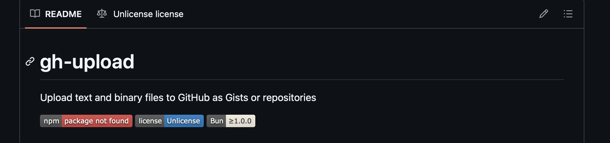
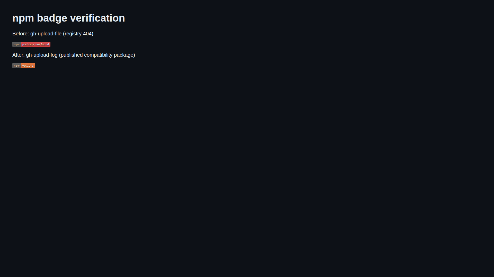

# Issue #53: npm badge says “package not found”

[Issue](https://github.com/link-foundation/gh-upload-log/issues/53) ·
[Pull request](https://github.com/link-foundation/gh-upload-log/pull/54)

## Findings

The README queried npm for `gh-upload-file`, which has never successfully
published. On 2026-10-20, its package metadata, latest-version endpoint and
dist-tags endpoint all returned 404. The compatibility package `gh-upload-log`
exists, with `latest: 0.10.1`. Its badge renders `v0.10.1`.

The fixed README badge intentionally describes that compatibility package; it
does **not** imply the universal package or version 0.12.0 is available. The
installation section now makes this distinction explicit.





## Timeline and sequence

| Time (UTC)               | Event and evidence                                                                                                                                                                                                                                              |
| ------------------------ | --------------------------------------------------------------------------------------------------------------------------------------------------------------------------------------------------------------------------------------------------------------- |
| 2026-10-08 10:59         | PR #51 merged universal/binary uploads and dual-name publishing. The preferred package was `gh-upload`; compatibility remained `gh-upload-log`. See `data/pr-51.json`.                                                                                          |
| 2026-10-08 11:41         | Release run 37771767171 attempted 0.11.0 and failed with npm E404. `data/release-37771767171.log` lines 6535–6574 preserve its final diagnostics.                                                                                                               |
| Before PR #52            | Its author also observed npm rejecting `gh-upload` as too similar to `rc-upload` (403). This is reported evidence in `data/pr-52.json`, not a result reproduced here. Syntax/name availability checks do not guarantee npm acceptance.                          |
| 2026-10-12 14:40:49      | PR #52 merged the rename to `gh-upload-file`, including the README badge and installation/import examples.                                                                                                                                                      |
| 2026-10-12 14:40:52      | Run 38264680940 started for SHA `440ba3304e96e9d4d663d2b3f683799c624321b0`; versioning committed 0.12.0 before publication.                                                                                                                                     |
| 2026-10-12 14:42:55      | Publication failed after three attempts. `data/release-38264680940.log` lines 6246–6279 show E404 on PUT of `gh-upload-file@0.12.0`; lines 6417–6454 show failure and job exit 1. Publication never reached the alias because the primary package failed first. |
| 2026-10-20               | Issue #53 reports a red badge while release-specific badges look valid. The issue has no comments or required sub-issues. Complete issue metadata is archived in `data/issue.json`.                                                                             |
| 2026-10-20 investigation | Direct registry requests and Shields reproduce the screenshot. Tests first fail twice, then pass after the badge and diagnostics fix. Browser comparison is above.                                                                                              |

## Root causes and limits

1. **Badge:** an unpublished package name was advertised in the README. Shields
   correctly reports missing data. Its [npm service](https://github.com/badges/shields/blob/master/services/npm/npm-version.service.js)
   queries `/-/package/<name>/dist-tags` and maps 404 to `package not found`.
   A captured copy is in `data/shields-npm-version.txt`. This is not evidence of
   a Shields caching defect; forcing cache refresh cannot publish a package.
2. **Release discrepancy:** `scripts/format-release-notes.mjs` builds static
   `/badge/<name>-<version>-blue.svg` labels linking to exact npm versions.
   Those labels do not query the registry. Older releases also refer to the
   successfully published legacy name. A visible badge alone proves neither
   that a new release exists on npm nor that a link resolves. `data/releases.json`
   preserves the release bodies. The current release pipeline already gates new
   release creation on verified publication of every package; that safeguard
   correctly stopped these failed runs.
3. **Delivery:** E404 is the observed failure, not a unique diagnosis. The
   [npm trusted-publishing documentation](https://docs.npmjs.com/trusted-publishers/)
   requires configuring a publisher on the individual package's settings.
   Renaming a package does not transfer the old package's trust. The workflow
   already uses Node 24, npm ^11.5.1 and `id-token: write`. A missing first
   publication/authorization is the leading explanation; ownership and private
   publisher configuration cannot be inspected from these public logs. We
   cannot distinguish all authorization causes or verify recovery without npm
   account access. This uncertainty is preserved rather than claiming a proven
   trust mismatch.
4. **Documentation:** the rename left the publishing instructions pointing at
   `gh-upload`, artifact `dist/npm/gh-upload`, and PR #51. These current
   instructions now consistently use `gh-upload-file` and this branch. Older
   case studies remain historical records, not current setup instructions.

## Requirements and evidence

| Requirement from issue/feedback                                                      | Implementation and verification                                                                                                                                                                                                                                                                                                    |
| ------------------------------------------------------------------------------------ | ---------------------------------------------------------------------------------------------------------------------------------------------------------------------------------------------------------------------------------------------------------------------------------------------------------------------------------- |
| Investigate badge and version-specific release discrepancy                           | Registry/dist-tags/Shield responses, screenshot, release bodies and service source archived; root causes above.                                                                                                                                                                                                                    |
| Download all available related logs/data into this case-study folder                 | Full logs of both failed main releases; main run timestamps/SHAs; issue and related PR metadata; all three PR #54 feedback types; screenshot; live response headers. npm runner-local debug files were named in the logs but are unavailable after the runner is destroyed. No artifacts containing them were supplied.            |
| Deep analysis, timeline, every requirement and solution plans                        | This document, including confirmed observations and uncertain account-side causes. No required sub-issues or additional feedback existed at investigation time.                                                                                                                                                                    |
| Search online and evaluate components                                                | Official npm docs, Shields source, existing npm diagnostics issue; alternatives below.                                                                                                                                                                                                                                             |
| Add diagnostics when root cause cannot be uniquely determined                        | E404/E403 publication errors retain original output and append actionable first-publish/trust instructions. Existing retry/progress logging remains. Read-only `experiments/issue-53-badge-probe.mjs --verbose` records response statuses, timestamps and headers; verbose headers are off by default.                             |
| Report related upstream problems with reproduction, workarounds and code suggestions | Added a concrete reproduction to existing [npm/cli#9088](https://github.com/npm/cli/issues/9088#issuecomment-6301562662), avoiding a duplicate issue. Full report is `data/upstream-report.md`; explicitly does not claim an npm registry defect.                                                                                  |
| Apply fixes across affected codebase                                                 | Audited badge references, release formatter, dual-package publisher, current README install/import/setup and historical case studies. Only the live README npm badge queried the absent package. Static release badges retain their version-specific meaning. Both publishing workflows share the corrected publisher diagnostics. |
| Reproduce first and prevent regressions                                              | `test/issue-53.test.js`: archived registry fixture verifies dynamic badge/link names match a real published latest tag; mocked E404 verifies actionable diagnostics. `data/regression-before.log` has two failures; `data/regression-after.log` has two passes. Tests require no network or npm credentials.                       |
| Visual evidence                                                                      | Original screenshot and Playwright rendering of actual captured before/after SVG responses committed here. This is badge rendering evidence, not a screenshot of an already merged GitHub README.                                                                                                                                  |
| Single PR, release preparation and full validation                                   | One patch changeset, all implementation/evidence in PR #54. Full local test/check results and current-head CI are recorded in the PR.                                                                                                                                                                                              |

## Solutions, components and recovery plan

The immediate correction uses the existing Shields npm badge against the
published compatibility package and labels it explicitly in alt text and prose.
It remains dynamic and follows that package's latest npm dist-tag. A static
0.12.0 badge would conceal the delivery problem. A GitHub release badge would
measure source releases instead of npm availability. Switching badge vendors
would still query an absent package. No additional library or service is needed.

The existing `isVersionPublished`/`publishPackages` helpers already verify exact
versions using uncached requests, resume partial publication and reject registry
errors. Changesets supplies the next patch release; adding a second publishing
framework would duplicate those safeguards. The repository's documented
[package-registry-manager](https://github.com/link-foundation/package-registry-manager/blob/main/docs/registry-setup.md)
can assist account-approved bootstrap and trust setup. Its use requires npm
account/browser authorization; GitHub repository access does not supply that.

Recovery for the preferred package remains **unverified and externally blocked**:

1. An authorized npm maintainer should inspect ownership and first-publish
   authorization for `gh-upload-file`, then bootstrap that exact name. Use the
   corrected setup command in the repository README, inspect its plan and
   approve its npm account operations.
2. Configure each package's trusted publisher separately for repository
   `link-foundation/gh-upload-log`, workflow `release.yml`, ensuring the allowed
   action includes publication and any environment matches the workflow.
3. Retry the release from main after merging. Verify both exact versions and
   both `latest` tags directly from npm, and install the packed/published tool.
   Successful CI on this PR does not verify npm authorization or delivery.
4. Only after those checks, optionally switch the README badge to
   `gh-upload-file` and remove the dated availability note. Refresh the registry
   fixture and badge regression test together. No publication or trust settings
   were changed in this investigation.

Until then `bun install -g gh-upload-log` installs the published 0.10.1 text-log
tool; do not promise binary-upload features from that version. The PR remains
unmerged and does not claim to have repaired npm account authorization.

## Reproduction

```sh
bun experiments/issue-53-badge-probe.mjs --verbose
bun test test/issue-53.test.js
bun test
bun run check
```

`data/live-probe.jsonl` is the timestamped probe output. Captured raw bodies and
headers are evidence from one point in time, not a promise of future registry
state. Upstream documentation HTML is archived as `data/npm-trusted-publishers.html`;
links above identify the live primary sources.
